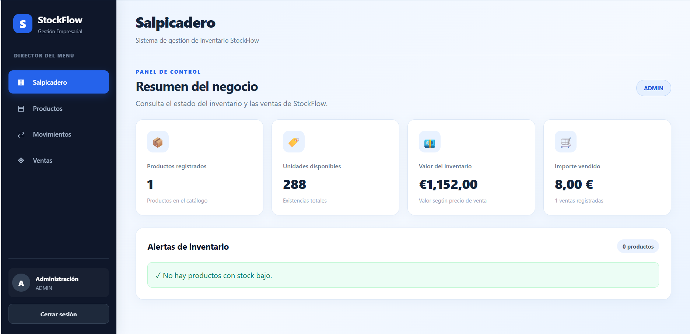
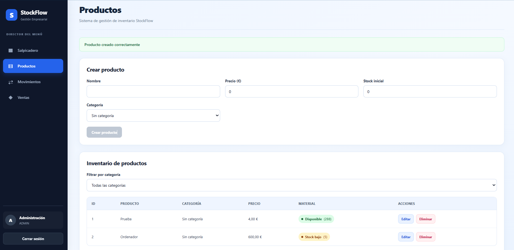
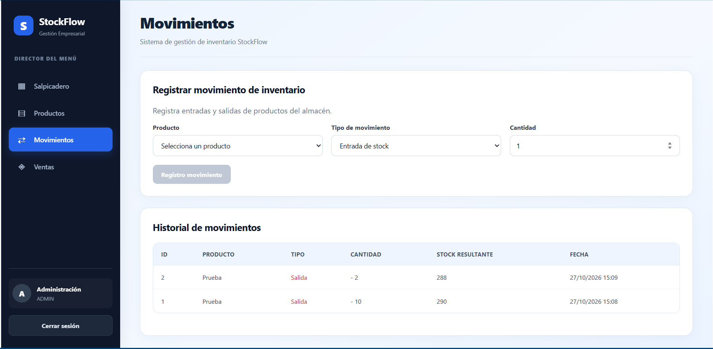
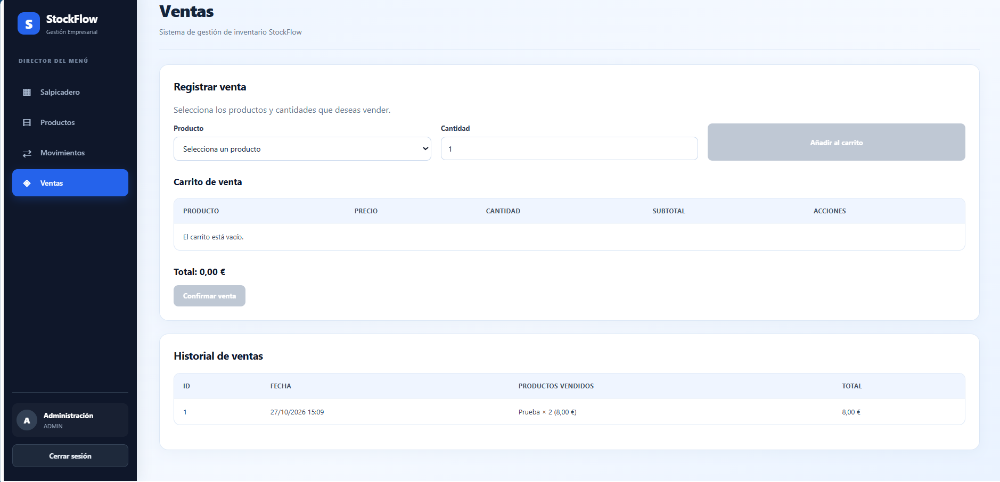
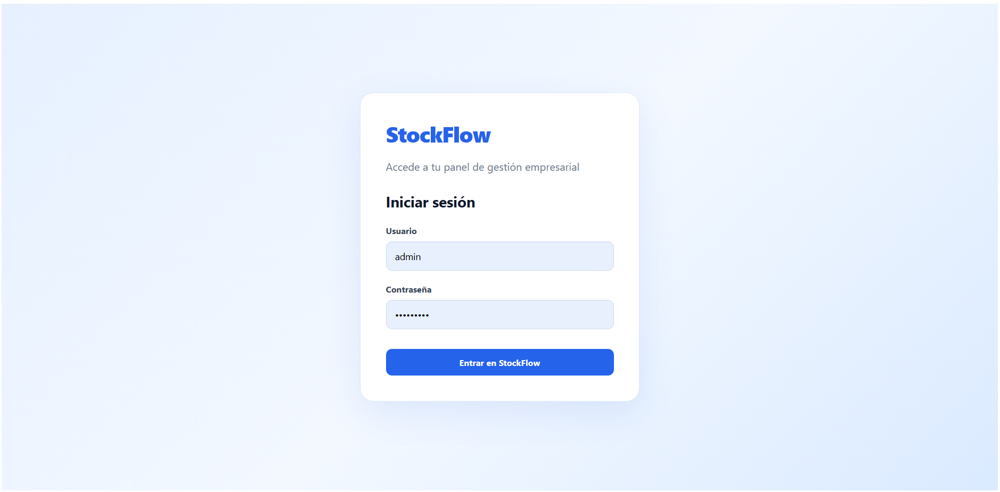
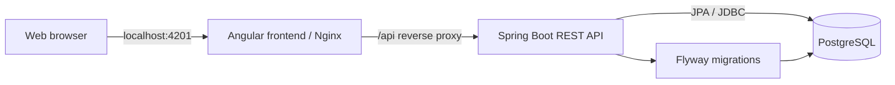

# StockFlow

**Full-stack Inventory & Sales Management System**

StockFlow is a full-stack web application for managing products, inventory movements, and sales in one place. It provides a role-aware interface, a business overview dashboard, and a persistent PostgreSQL database.

Built as a hands-on portfolio project using **Java 21, Spring Boot, Angular, PostgreSQL, Flyway, and Docker Compose**.

> **Project status:** Functional local demonstration. Designed for learning and portfolio review, not for deployment as a production-ready public service.

## Application preview

### Dashboard



### Product management



### Stock movements



### Sales



<details>
<summary>Login screen</summary>



</details>

## Features

- **Dashboard:** View the number of registered products, available stock units, estimated inventory value, sales totals, and low-stock alerts.
- **Product management:** Create, view, edit, and delete products, set prices and initial stock, and assign categories.
- **Category-based filtering:** Browse products by category.
- **Stock movements:** Register incoming and outgoing stock changes and inspect movement history, including the resulting stock.
- **Sales workflow:** Add products and quantities to a cart, confirm a sale, update stock, and view previous sales.
- **User roles:** Authenticate as an `ADMIN` or `EMPLOYEE`, with role-based access rules in the backend.
- **Persistent data:** Store business data in PostgreSQL using a Docker volume and version the database schema using Flyway migrations.
- **Automated tests:** 31 backend tests passed in the local development environment.

## Tech stack

| Layer | Technologies |
| --- | --- |
| Frontend | Angular 22, TypeScript, SCSS |
| Backend | Java 21, Spring Boot 4, Spring Security, Spring Data JPA |
| Database | PostgreSQL 18 |
| Migrations | Flyway |
| Build & testing | Maven Wrapper, JUnit |
| Containerization | Docker, Docker Compose, Nginx |

## Architecture



The frontend is exposed on **`http://localhost:4201`**. Docker Compose keeps the Spring Boot API and PostgreSQL service on the internal Docker network. Nginx forwards `/api` requests to Spring Boot.

## Getting started with Docker

### Prerequisites

- Git
- Docker Desktop (or Docker Engine with Docker Compose)

### 1. Clone the repository

```bash
git clone https://github.com/davidperezjimenezeso-lab/stockflow.git
cd stockflow
```

### 2. Configure environment variables

Create a local `.env` file from the example:

**PowerShell (Windows):**

```powershell
Copy-Item .env.example .env
```

**macOS / Linux:**

```bash
cp .env.example .env
```

Edit `.env` and replace **all** placeholder values with strong, unique passwords:

```dotenv
DB_PASSWORD=your_unique_database_password
STOCKFLOW_ADMIN_PASSWORD=your_unique_admin_password
STOCKFLOW_EMPLOYEE_PASSWORD=your_unique_employee_password
```

The `.env` file is excluded from Git. Do not commit actual credentials.

### 3. Build and start

```bash
docker compose up --build -d
```

Open **http://localhost:4201**.

Log in with one of the initial accounts:

| Username | Password |
| --- | --- |
| `admin` | The value of `STOCKFLOW_ADMIN_PASSWORD` in your `.env` |
| `employee` | The value of `STOCKFLOW_EMPLOYEE_PASSWORD` in your `.env` |

The initial users are seeded **only if they do not already exist**. Editing their passwords in `.env` later does **not** reset the passwords stored in an existing database.

### Useful Docker commands

```bash
# Check service status
docker compose ps

# Inspect backend logs
docker compose logs -f backend

# Stop containers (preserves the database volume)
docker compose down

# Start them again
docker compose up -d
```

**Data persistence:** PostgreSQL uses a named Docker volume. `docker compose down` does not delete it. Avoid `docker compose down -v` unless you intentionally want to delete the database volume and its data.

## Testing

Run the backend test suite from the `backend` directory with Java 21 and the required environment variables configured:

**PowerShell:**

```powershell
cd backend
$env:DB_PASSWORD = Read-Host "Local PostgreSQL password"
$env:STOCKFLOW_ADMIN_PASSWORD = Read-Host "Admin seed password"
$env:STOCKFLOW_EMPLOYEE_PASSWORD = Read-Host "Employee seed password"
.\mvnw.cmd clean test
```

**Local verification:** 31 tests passed, with 0 failures and 0 errors.

> The Spring Boot context-loading test currently requires access to a configured PostgreSQL instance. For local Maven testing, the application configuration points to `localhost:5432/stockflow_db`; running Docker Compose alone does not expose its database on that host port. A dedicated isolated test database or Testcontainers integration is a planned improvement.

To build the Angular frontend independently:

```bash
cd frontend
npm install
npm run build -- --configuration production
```

## Security considerations

- Spring Security protects API endpoints and applies access rules by user role.
- User passwords are stored as BCrypt hashes.
- Database and seeded-user passwords are supplied through environment variables instead of hardcoded credentials.
- The current demo uses **HTTP Basic authentication** and is intended for **local development**. HTTP Basic credentials are merely Base64-encoded in transport; deploying publicly would require HTTPS and further hardening.
- The app should not be considered a production authentication or authorization reference without additional review, including session/token handling, security headers, and deployment configuration.

## Project structure

```text
stockflow/
├── backend/               # Spring Boot REST API, domain logic and tests
│   └── src/main/resources/db/migration/  # Flyway migrations
├── frontend/              # Angular UI and Nginx configuration
├── docs/screenshots/      # Application screenshots
├── docker-compose.yml     # Application stack
├── .env.example           # Environment variable template
└── README.md
```

## Potential next steps

- Add continuous integration with GitHub Actions.
- Isolate integration tests from the developer database with Testcontainers.
- Improve authentication and deployment security for non-local environments.
- Extend reporting and inventory analytics.

---

*StockFlow is a personal software engineering portfolio project demonstrating full-stack development, relational data modeling, business logic, automated tests, and containerized deployment.*
